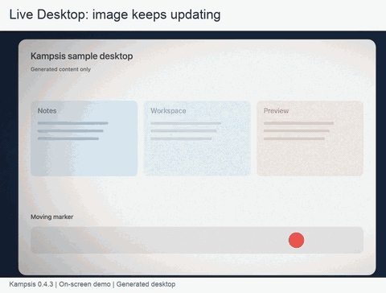
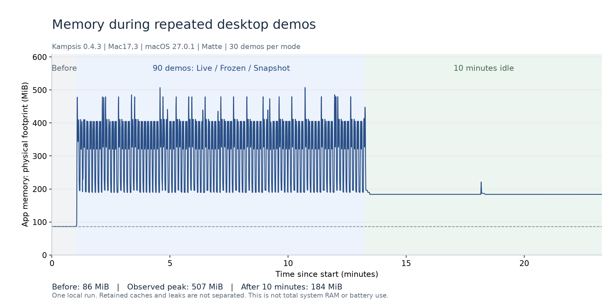

<p align="center">
  
</p>

# Kampsis

Русский · [English](README.md)

Рабочий стол складывается, размывается и затемняется, когда вы закрываете крышку MacBook. Откройте её, и экран вернётся к обычному виду.



[Посмотреть MP4](assets/readme/desktop-modes.mp4), чтобы оценить записанное движение, или открыть [неподвижный кадр](assets/readme/desktop-modes-poster.png). GIF служит уменьшенным предпросмотром. Это экранное демо с собственным тестовым содержимым; физическое движение крышки не снималось. Заморозка и одиночный снимок выглядят похоже, но получают картинку по-разному: различие объясняется ниже. Эти демо записаны в 0.4.3: при возврате там видны осветление и двоение. В 0.4.5 снимок сначала выравнивается, затем заменяется текущим экраном без смешивания двух картинок.

## Установка

Нужны macOS 26 или новее и MacBook с Apple silicon и датчиком угла крышки. Эта версия проверена на Mac17,3; работа на других моделях пока экспериментальная. Эффект появляется только на встроенном экране.

1. Скачайте **Kampsis-v0.4.5-macos-arm64.dmg** со страницы [релизов](https://github.com/boundlessend/kampsis/releases/latest).
2. Откройте образ и перетащите **Kampsis** в **Программы**.
3. Запустите Kampsis. Если macOS блокирует запуск, откройте **Системные настройки → Конфиденциальность и безопасность → Всё равно открыть**. Приложение подписано собственным сертификатом проекта и не нотарифицировано Apple.
4. Нажмите **Allow Screen Access…** и разрешите Kampsis **запись экрана**. Перезапустите приложение, если macOS попросит.

Установка опубликованной версии через Homebrew:

```sh
brew tap boundlessend/kampsis https://github.com/boundlessend/kampsis
brew install --cask boundlessend/kampsis/kampsis
```

Для обновления завершите Kampsis, затем выполните `brew update` и `brew upgrade --cask boundlessend/kampsis/kampsis`. Homebrew может попросить доверять стороннему tap; перед подтверждением просмотрите cask.

## Использование

- **Левый клик по иконке в строке меню** включает или выключает эффект. **Правый клик** открывает меню. Когда эффект выключен, иконка приглушена.
- Нажмите **⌘⌥B**, чтобы переключить эффект. Сочетание можно изменить в **Общих настройках**.
- Откройте **Настроить эффект…**, выберите стиль и настройте изгиб, размытие и затемнение. Результат виден в предпросмотре.
- **Развитие эффекта** определяет, насколько рано эффект проявляется при закрытии крышки. **Опережение крышки** учитывает её движение и действует раньше измеренного угла: выберите **Крышка** в предпросмотре или нажмите **Проверить с крышкой**. На предпросмотр с ползунком и демонстрацию опережение не влияет.
- Выберите **Показать на экране**, чтобы увидеть пятисекундную демонстрацию на своём рабочем столе.
- В **Общих настройках** можно включить запуск при входе, звук открытия крышки и показ иконок в Dock и строке меню. При входе приложение запускается в фоне без открытия окна. Кнопка **Настроить эффект…** возвращает к параметрам эффекта.
- При первом запуске интерфейс на английском. Для русского откройте **General Settings → Language → Русский**, затем перезапустите Kampsis.

По умолчанию иконка в Dock скрыта, а в строке меню видна. Если вы скрыли обе, откройте Kampsis из **Программ**: появятся Общие настройки, где можно вернуть иконки.

## Режимы изображения рабочего стола

Выберите режим в **Общих настройках → Доступ к экрану → Изображение рабочего стола**. Для новых настроек исходный режим: одиночный снимок. Сохранённый выбор остаётся прежним.

| Режим | Что видно во время сгиба | Указатель | Когда выбирать |
|---|---|---|---|
| **Одиночный снимок** | Одна картинка в начале каждого сгиба, без постоянного потока | Скрыт до конца эффекта | Нужна неподвижная картинка и обычный запуск приложения |
| **Живой рабочий стол** | Картинка продолжает обновляться | Видим | Нужно видеть видео, движение окон и другие изменения во время эффекта |
| **Заморозка в начале сгиба** | Удерживается подготовленный кадр, поток останавливается | Скрыт до конца эффекта | Нужна заранее подготовленная картинка, которая не меняется во время сгиба |

В заморозке и одиночном снимке приложения продолжают реагировать на ввод, но изменения под картинкой станут видны только после окончания эффекта. Для точного клика дождитесь возвращения рабочего стола. В живом режиме картинка обновляется, однако области нажатия остаются на исходных местах при изгибе изображения.

Предпросмотр с ползунком использует пример рабочего стола; **Показать на экране** использует выбранный режим. На Mac17,3 с macOS 27.0.1 одиночный снимок работал без постоянного фиолетового индикатора и Terminal в Dock. Индикатором управляет macOS; другие системы не проверены.

**Экспериментальный запуск через Terminal** доступен по желанию для живого захвата и заморозки, но недоступен для одиночного снимка. На некоторых версиях macOS он может скрыть индикатор потока. Требует разрешить Kampsis управлять Apple Terminal, а Terminal - запись экрана; этот доступ распространяется и на другие команды Terminal. Kampsis закрывает своё окно запуска и сохраняет существующие окна Terminal. Пока работает Kampsis, Terminal может оставаться в Dock. Выбор одиночного снимка возвращает обычный запуск приложения. Обновление macOS может вернуть индикатор.

Повреждённая запись параметров эффекта оставляет эффект выключенным и сопровождается сообщением восстановления. **Сбросить параметры эффекта…** заменяет запись только после подтверждения; эффект остаётся выключенным до отдельного включения.

Команды сборки и проверок находятся в [руководстве разработчика](docs/DEVELOPMENT.md).

## Совместимость

| Mac / macOS | Что проверено |
|---|---|
| Mac17,3 / macOS 27.0.1 | Показания датчика, демо всех трёх режимов, захват и поведение указателя |
| macOS 26 | Сборка и тесты без оборудования в CI; эффекты на физическом Mac не проверены |
| Другие MacBook с Apple silicon и датчиком угла крышки | Экспериментальная поддержка, широкой проверки моделей нет |
| Intel Mac или Windows | Этот выпуск не поддерживает |
| Внешний монитор | Эффект предназначен для встроенного экрана; переходы с внешним монитором на оборудовании не проверены |

Новые проверки медленных и быстрых наклонов, настоящих переходов сна/блокировки и Reduce Motion пока не выполнены. Автоматические тесты событий контроллера их не заменяют. Идентификатор модели виден в **Общих настройках → Статус** и **Скопировать диагностику**.

## Расход ресурсов

На проверенном Mac 90 повторных демо начинались примерно с 86 MiB памяти, достигали 507 MiB и оставляли 184 MiB после десяти минут простоя. В этом окне память была стабильной, но к исходному уровню не вернулась; кеш и утечка не разделены.



Это один локальный прогон с тяжёлым стилем Matte. Короткие демо показывали в среднем около 59-60 FPS с отдельными длинными интервалами между кадрами; оценка мощности относится ко всему Mac и не доказывает экономию батареи. [Метод, численные данные и ограничения](docs/PERFORMANCE.md).

## Похожие проекты

Сравнение возможностей, проверено 2026-10-09. Требования macOS указаны по документации проектов; другие приложения в наших замерах не запускались

| Приложение | Возможности | Заявленная macOS |
|---|---|---|
| Kampsis 0.4.3 | Выбор Live/Frozen/Snapshot; Soft/Deep/Matte; English/Русский; DMG или Homebrew | 26+ |
| [Lid Plane](https://github.com/jh3y/lid-plane/blob/ba290ffc1ade87325b93133374c0d12197bac6c2/README.md) | Живая картинка, перспектива и размытие | 13+ |
| [Mac Duo](https://github.com/Toketec/mac-duo/blob/b29c9ccbc7291a8a53ede162e65cb4cbf50527b9/README.md) | Живая картинка, диапазон сгиба и предпросмотр | 14+ |
| [Foldbook](https://github.com/shivamchopra7/Macbook-Duo-App/blob/5488d821e05c6cd3148cab0157e725cff6894a63/README.md) | Живая картинка, 12 эффектов | 13+ |
| [macTilt](https://github.com/lqSky7/iphone-duo-macos-animation/blob/a1745b9159d64fae38038b24d5d0e5fcb09f2ce3/README.md) | Неподвижная картинка, настройки наклона | 14+ |
| [Bendable](https://github.com/opensourcevillain/Bendable/blob/13848be18f16ce9239f1e719e4e1f62b18dd6787/README.md) | Снимок для стилей рабочего стола, 9 стилей | 14+ |
| [Shut](https://github.com/notthamer/shut/blob/667e3e5582affa035e5d46cfa915c0210d6544f2/README.md) | Снимок для стилей рабочего стола, 8 стилей и пресеты | 14+ |

В Kampsis можно выбрать поведение картинки. У части альтернатив больше эффектов или есть поддержка старых macOS. Измеренного рейтинга скорости и расхода батареи нет. [Версии исходников и подробности](docs/COMPARISON.md).

## Обновления

Выберите **Проверить обновления…** в меню или включите ежедневную проверку в Общих настройках. Ежедневная проверка показывает доступную версию в меню и Общих настройках без диалога поверх других приложений. Скачайте новую версию и замените Kampsis в Программах. Ваши настройки сохранятся.

## Разрешения и конфиденциальность

| Доступ | Зачем он нужен |
|---|---|
| Запись экрана для Kampsis | Получить изображение встроенного экрана для эффекта, в том числе для одиночного снимка |
| Управление Terminal и запись экрана для Terminal | Только для экспериментального запуска; доступ Terminal распространяется и на другие команды в нём |
| Соединение с GitHub | Прочитать информацию о релизе при проверке обновлений; автоматическую проверку можно выключить |

Для обычного эффекта не нужны камера, микрофон, Универсальный доступ или Мониторинг ввода. Нет аккаунтов, аналитики и сохранения снимков. Изображения остаются в памяти Mac и никуда не отправляются; звук не записывается. Захват прекращается, когда эффект выключен, Mac спит или заблокирован. Экспериментальный запуск через Terminal не даёт Kampsis официального управления системными индикаторами доступа.

## Что полезно знать

Защищённое видео может не отображаться в эффекте. При закрытии крышки MacBook засыпает как обычно.

Если эффект не работает, откройте **Общие настройки**, проверьте доступ к записи экрана и состояние датчика, затем нажмите **Проверить ещё раз**. Кнопка **Скопировать диагностику** копирует технический отчёт без снимков экрана для сообщения о проблеме.

[Сообщить о проблеме](https://github.com/boundlessend/kampsis/issues) · [Лицензия](LICENSE)
